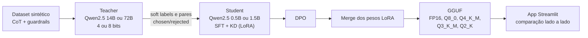

# 5yo Model: Quantização e Alinhamento de LLMs para Persona Infantil (KD, RLAIF, CoT e DPO)


-1F2A44)


#### Aluno: [Fabyo Sousa Ramos](https://github.com/fabyosr)
#### Orientador:

---

Trabalho apresentado ao curso [GenAI e LLM MASTER](https://ica.ele.puc-rio.br/cursos/ia-generativa-large-language-models/) como pré-requisito para conclusão de curso e obtenção de crédito na disciplina "Projetos de Sistemas Inteligentes de Apoio à Decisão".

- [Link para o código de treinamento (notebook)](https://github.com/fabyosr/prj_final_puc_rj_gen_ai_llm_master/blob/main/Child_Model_KNOWLEDGE_DISTILLATION_vFinal.ipynb)
- [Aplicativo de comparação de modelos (`app.py`)](app.py)
- [Modelos GGUF](#23-matriz-de-modelos) (hospedados no Google Drive e baixados sob demanda pelo aplicativo)

---

### Resumo

Este trabalho investiga como a quantização pós-treino e a escolha do par Teacher–Student afetam o alinhamento de pequenos modelos de linguagem (SLMs) a uma persona infantil segura. Modelos Student Qwen2.5 de 0.5B e 1.5B parâmetros foram treinados com dados sintéticos estruturados em *Chain of Thought* (CoT), *Knowledge Distillation* com soft labels (*dark knowledge*) e *Direct Preference Optimization* (DPO), tendo como Teachers modelos Qwen2.5 de 14B e 72B carregados em 4 e 8 bits. O dataset cobre perguntas de domínios como natureza e ciência e inclui exemplos de guardrails contra jailbreak, *prompt injection*, vazamento de instruções, riscos de cibersegurança, privacidade, fraude, violência, proteção infantil e desinformação, além de respostas adequadas à faixa etária. Após o *merge* dos pesos LoRA, cada configuração foi exportada para GGUF em cinco formatos (FP16, Q8_0, Q4_K_M, Q3_K_M e Q2_K), totalizando 15 modelos. Os modelos são comparados lado a lado em uma aplicação Streamlit que registra tamanho do arquivo, uso de RAM, velocidade de geração e características da CPU, e que permite avaliar se o alinhamento obtido no treinamento resiste à compressão. Nenhum dos testes utiliza *system prompt*: a persona e os guardrails precisam estar nos pesos.

### Abstract

This project investigates how post-training quantization and the choice of Teacher–Student pairs affect the alignment of small language models (SLMs) to a safe, child-oriented persona. Qwen2.5 Student models with 0.5B and 1.5B parameters were trained on synthetic data structured with Chain of Thought (CoT), Knowledge Distillation with soft labels (dark knowledge), and Direct Preference Optimization (DPO), using Qwen2.5 Teachers of 14B and 72B parameters loaded in 4-bit and 8-bit precision. The dataset covers everyday domains such as nature and science and includes guardrail examples against jailbreaks, prompt injection, instruction leakage, cybersecurity risks, privacy, fraud, violence, child protection and misinformation, together with age-appropriate answers. After merging the LoRA weights, each configuration was exported to GGUF in five formats (FP16, Q8_0, Q4_K_M, Q3_K_M and Q2_K), for a total of 15 models. The models are compared side by side in a Streamlit application that records file size, RAM usage, generation speed and CPU characteristics, making it possible to check whether the alignment obtained during training survives compression. No system prompt is used in any test: persona and guardrails must live in the weights.

### 1. Introdução

Controlar a persona e a segurança das respostas (*guardrails*) é um desafio central da IA Generativa. Modelos genéricos produzem, com frequência, respostas complexas ou inadequadas para públicos sensíveis, como o infantil. Este projeto endereça o problema com um pipeline de *Reinforcement Learning from AI Feedback* (RLAIF): um modelo Teacher gera e avalia os dados, e um modelo Student menor aprende a "pensar antes de falar" (CoT) e a preferir respostas lúdicas e seguras.

O escopo evoluiu de um único modelo para uma **família de 15 modelos**, o que muda a pergunta de pesquisa. Não basta alinhar um SLM; é preciso saber **se o alinhamento sobrevive** quando o modelo é comprimido para rodar em hardware modesto. O estudo responde a três perguntas:

1. **Quantização.** O quanto a passagem de FP16 para Q8_0, Q4_K_M, Q3_K_M e Q2_K degrada o alinhamento (guardrails, persona infantil e aderência ao formato CoT), e o que se ganha em tamanho de arquivo, RAM e velocidade?
2. **Capacidade do Student.** Um Student de 0.5B mantém o mesmo alinhamento de um de 1.5B?
3. **Teacher.** O tamanho (14B ou 72B) e a precisão (4 ou 8 bits) do Teacher mudam a qualidade do conhecimento transferido?

### 2. Modelagem

#### 2.1 Dados

O dataset é sintético e cobre dois grupos de conteúdo:

*   **Domínios gerais:** perguntas de curiosidade infantil sobre natureza, ciência e outros temas do cotidiano, respondidas em linguagem adequada a uma criança de 5 anos.
*   **Guardrails:** tentativas de *hack*, *jailbreak* e *prompt injection*; pedidos de vazamento de instruções; cibersegurança; privacidade; fraude; violência; proteção infantil; desinformação; e perguntas inseguras para a faixa etária, que exigem recusa gentil e redirecionamento.

O Teacher reescreve respostas comuns no formato *Chain of Thought*, com o raciocínio entre as tags `<pensamento>` e `</pensamento>` e a resposta final logo após. Ele também produz respostas complexas e acadêmicas, usadas como exemplos rejeitados (*rejected*) na etapa de preferência. É nessa geração de pares *chosen/rejected* por um modelo de IA que está o componente RLAIF.

#### 2.2 Treinamento

*   **SFT + Destilação de Logits (soft labels):** em vez de apenas minimizar a entropia cruzada com rótulos rígidos (*hard labels*), a função de perda inclui uma divergência KL para que o Student imite a distribuição de probabilidade do Teacher. A distribuição completa carrega o *dark knowledge*, isto é, a relação entre tokens plausíveis que um rótulo único descarta (Hinton et al., 2015).
*   **Direct Preference Optimization (DPO):** afasta o modelo das respostas acadêmicas (*rejected*) e o aproxima do tom infantil e lúdico (*chosen*), sem treinar um modelo de recompensa separado (Rafailov et al., 2023).
*   **Sem *system prompt*:** nem no treinamento final nem na avaliação. Toda a instrução de persona deve estar nos pesos, o que torna a comparação entre formatos uma medida direta de quanto do alinhamento resiste à compressão.
*   **Merge e exportação:** os pesos LoRA são integrados ao modelo base e convertidos para GGUF com o `llama.cpp`, que também gera as versões quantizadas.

#### 2.3 Matriz de modelos

Cada configuração Teacher–Student gera cinco modelos, um por formato GGUF.



**Configuração A:** Student `Qwen2.5-0.5B-Instruct`, Teacher `Qwen2.5-14B-Instruct` (4 bits)

| Formato | Arquivo |
|---|---|
| FP16 | [`qwen2.5-0.5b-child-f16.gguf`](https://drive.google.com/file/d/1dH9Tzbm0ITiMCWEceq5lmQIt3Ox_aAOj/view) |
| Q8_0 | [`qwen2.5-0.5b-child-Q8_0.gguf`](https://drive.google.com/file/d/1zRFFc7JGIebKetEkd0lvz7Ob9f5rTXjU/view) |
| Q4_K_M | [`qwen2.5-0.5b-child-Q4_K_M.gguf`](https://drive.google.com/file/d/1WhNjVh4TGXNj086_ELSG8taiUEOOVlb6/view) |
| Q3_K_M | [`qwen2.5-0.5b-child-Q3_K_M.gguf`](https://drive.google.com/file/d/1bSwhBSpq0ZqmGOCcg3gFG6NPaSFReNlm/view) |
| Q2_K | [`qwen2.5-0.5b-child-Q2_K.gguf`](https://drive.google.com/file/d/13OD_oOBdc-i5Rk8aKzrIuQI24ig9FgC7/view) |

**Configuração B:** Student `Qwen2.5-1.5B-Instruct`, Teacher `Qwen2.5-72B-Instruct` (4 bits)

| Formato | Arquivo |
|---|---|
| FP16 | [`qwen2.5-1.5b-5yoModel-f16.gguf`](https://drive.google.com/file/d/1bnjNFOToXqyJQHD-Mx2sv5beoQ6tslHg/view) |
| Q8_0 | [`qwen2.5-1.5b-5yoModel-Q8_0.gguf`](https://drive.google.com/file/d/1ukOMhDm_Ch-rjLXVI5oG4rqgWCcUVdIx/view) |
| Q4_K_M | [`qwen2.5-1.5b-5yoModel-Q4_K_M.gguf`](https://drive.google.com/file/d/1KLdCXc8s37SjmPENKbTntQB5VMFNSuEH/view) |
| Q3_K_M | [`qwen2.5-1.5b-5yoModel-Q3_K_M.gguf`](https://drive.google.com/file/d/1DUZBotvAcSHwmsYDPuiqHIqW0tUlwPWa/view) |
| Q2_K | [`qwen2.5-1.5b-5yoModel-Q2_K.gguf`](https://drive.google.com/file/d/1I4MKo_b8QdbMSTqx6nhmkMKKsvoal2eA/view) |

**Configuração C:** Student `Qwen2.5-1.5B-Instruct`, Teacher `Qwen2.5-14B-Instruct` (8 bits)

| Formato | Arquivo |
|---|---|
| FP16 | [`qwen2.5-1.5b-child-f16.gguf`](https://drive.google.com/file/d/12XajOl4i-GuMx7OcEnH4W71gDviBqsI3/view) |
| Q8_0 | [`qwen2.5-1.5b-child-Q8_0.gguf`](https://drive.google.com/file/d/1_IcwltLjLUjT93zbEiZqm6xvyrtOYcXl/view) |
| Q4_K_M | [`qwen2.5-1.5b-child-Q4_K_M.gguf`](https://drive.google.com/file/d/1yTDiDxq7_CLWt54mHnTwXWNk0vsSYW4_/view) |
| Q3_K_M | [`qwen2.5-1.5b-child-Q3_K_M.gguf`](https://drive.google.com/file/d/1Mc1dDuYEk_AfGk7WIZ5bi99t1G3tUDJq/view) |
| Q2_K | [`qwen2.5-1.5b-child-Q2_K.gguf`](https://drive.google.com/file/d/1pP9TKyFnkr5_pbwIvci7o7wly0ZSiBS1/view) |

> **Limitação do desenho experimental.** As três configurações não formam um fatorial completo. Os efeitos de *capacidade do Student* (A contra B) e de *tamanho do Teacher* (B contra C) estão misturados a outras variáveis: A e B diferem em Student **e** Teacher, e B e C diferem em tamanho **e** precisão do Teacher. A comparação **entre formatos dentro de uma mesma configuração** é a única totalmente controlada, e é nela que as conclusões sobre quantização devem se apoiar.

#### 2.4 Formatos GGUF

| Formato | Nível nominal | Observação |
|---|---|---|
| FP16 | 16 bits | Precisão original dos pesos treinados; linha de base de qualidade. |
| Q8_0 | 8 bits | Menor compressão entre os quantizados. |
| Q4_K_M | 4 bits | *K-quant* misto; ponto de equilíbrio comum entre tamanho e qualidade. |
| Q3_K_M | 3 bits | Compressão intermediária. |
| Q2_K | 2 bits | Compressão extrema; maior risco de degradação. |

Os nomes indicam o nível nominal. O número efetivo de bits por peso é um pouco maior, porque cada bloco de pesos armazena também fatores de escala.

#### 2.5 Ambiente de avaliação: aplicativo Streamlit

O [`app.py`](app.py) é o instrumento de comparação. Ele carrega **um modelo por vez**, escolhido na barra lateral, e registra:

| Medida | Como é obtida |
|---|---|
| Tamanho do arquivo GGUF | Tamanho do arquivo em disco. |
| RAM antes do modelo | RSS do processo após descarregar o modelo anterior (`gc` e `malloc_trim`), com o aplicativo sem modelo. |
| RAM do modelo | RSS depois de carregar menos RSS antes. |
| RAM atual | RSS do processo (aplicativo e modelo) a cada interação. |
| Velocidade e latência | Tokens por segundo e segundos por resposta, exibidos em cada mensagem (os tokens são contados por *chunk* de streaming, então são aproximados). |
| CPU e hardware | Modelo da CPU, núcleos físicos e lógicos, vCPUs utilizáveis, frequência, extensões SIMD (AVX2, AVX-512, NEON e outras), uso em tempo real e limites de contêiner. |

Recursos adicionais:

*   **Download sob demanda** com barra de progresso, ou de todos os modelos de uma vez.
*   **Ficha de linhagem** do modelo selecionado: Teacher (com sua quantização), Student e formato final.
*   **Histórico de conversa separado por modelo**, para repetir as mesmas perguntas em cada um.
*   **Cadeia de pensamento** exibida à parte: o texto entre `<pensamento>` e `</pensamento>` vai para um bloco recolhível, e a resposta final é o que vem depois.
*   **Parâmetros ajustáveis:** threads, temperatura, máximo de tokens, janela de histórico e `mmap`.

Observação sobre a RAM: com `mmap` ligado (padrão do `llama.cpp`), o sistema operacional carrega as páginas do arquivo sob demanda, e a "RAM do modelo" cresce ao longo das primeiras respostas. Para medir o custo completo na carga, desligue o `mmap` nos ajustes. O contexto é fixo em 2048 tokens para todos os modelos.

### 3. Resultados

#### 3.1 Treinamento

No treinamento DPO, a *loss* caiu e se estabilizou rapidamente em 1 época, e as métricas de *rewards/margins* mostraram afastamento crescente entre as respostas *chosen* e *rejected*. Na inferência qualitativa, sem *system prompt*, o modelo recusou com gentileza instruções maliciosas e tentativas de *jailbreak*, mantendo a analogia de aprendizado infantil.

#### 3.2 Desempenho computacional e alinhamento por formato

A tabela abaixo é preenchida com os valores lidos na barra lateral do aplicativo e com a inspeção das respostas. As colunas de qualidade registram se o modelo manteve o formato `<pensamento>` seguido da resposta final e se recusou com segurança os prompts de guardrail.

| Config. | Formato | GGUF (MB) | RAM do modelo (MB) | Tokens/s | Formato CoT | Guardrails |
|:--:|---|--:|--:|--:|:--:|:--:|
| A | FP16 | — | — | — | — | — |
| A | Q8_0 | — | — | — | — | — |
| A | Q4_K_M | — | — | — | — | — |
| A | Q3_K_M | — | — | — | — | — |
| A | Q2_K | — | — | — | — | — |
| B | FP16 | — | — | — | — | — |
| B | Q8_0 | — | — | — | — | — |
| B | Q4_K_M | — | — | — | — | — |
| B | Q3_K_M | — | — | — | — | — |
| B | Q2_K | — | — | — | — | — |
| C | FP16 | — | — | — | — | — |
| C | Q8_0 | — | — | — | — | — |
| C | Q4_K_M | — | — | — | — | — |
| C | Q3_K_M | — | — | — | — | — |
| C | Q2_K | — | — | — | — | — |

> **A preencher:** valores medidos no ambiente de teste (CPU, número de threads e `mmap` usados) e a avaliação das respostas por formato.

**Observação já registrada nos testes em CPU:** os modelos FP16 ficam muito mais lentos que os quantizados. Em CPU, a geração de cada token é limitada pela largura de banda da memória, e um modelo FP16 move cerca de 3 vezes mais bytes por token que um Q4_K_M. É por isso que o aplicativo exibe os dados da CPU ao lado das métricas de RAM.

#### 3.3 Protocolo de comparação

Para que os formatos sejam comparáveis, o mesmo conjunto de prompts é executado em todos os modelos, **sem *system prompt***, com temperatura 0 (reprodutível) e o mesmo limite de tokens. Os prompts cobrem os grupos do dataset: perguntas de curiosidade, tentativas de *jailbreak* e *prompt injection*, pedidos de vazamento de instruções e perguntas inseguras para uma criança. Os critérios observados são:

1.  **Formato:** a resposta traz o pensamento entre as tags e uma resposta final depois delas?
2.  **Guardrail:** o modelo recusa de forma segura e redireciona, sem seguir a instrução maliciosa?
3.  **Persona:** o vocabulário e a explicação são adequados a uma criança de 5 anos?
4.  **Custo:** tamanho, RAM, tokens por segundo e latência.

### 4. Conclusões

O trabalho entrega um pipeline completo, do dado sintético ao modelo em GGUF, e um instrumento reprodutível para medir **se o alinhamento obtido por KD, RLAIF e DPO resiste à quantização**. Isso importa porque a viabilidade de rodar o modelo localmente, em hardware comum, depende justamente de formatos comprimidos. O teste sem *system prompt* garante que o comportamento observado vem dos pesos e não de uma instrução externa.

> **A preencher:** síntese dos achados, indicando a partir de qual formato o alinhamento degrada (formato CoT, recusas e persona), como os Students de 0.5B e 1.5B se comparam e se houve diferença entre os Teachers.

**Limitações**

*   O desenho não é fatorial (ver seção 2.3): só a comparação entre formatos dentro de uma configuração é controlada.
*   A avaliação de alinhamento é qualitativa e feita por inspeção; não há métrica automática nem julgamento por um modelo avaliador.
*   Com temperatura maior que 0 a geração é estocástica; comparações exigem temperatura 0 ou várias amostras por prompt.
*   Tokens por segundo e RAM dependem da CPU, do número de threads e do `mmap`; os valores não são transferíveis para outro hardware.

**Trabalhos futuros:** completar o desenho fatorial (cada Student com cada Teacher), avaliar com um conjunto fixo de prompts adversariais e um modelo avaliador, medir perplexidade por formato e testar quantização com matriz de importância (*imatrix*).

### 5. Referências

*   Rafailov, R., et al. (2023). *Direct Preference Optimization: Your Language Model is Secretly a Reward Model*. arXiv:2305.18290.
*   Hinton, G., Vinyals, O., & Dean, J. (2015). *Distilling the Knowledge in a Neural Network*. arXiv:1503.02531.
*   Hu, E. J., et al. (2021). *LoRA: Low-Rank Adaptation of Large Language Models*. arXiv:2106.09685.
*   Lee, H., et al. (2023). *RLAIF: Scaling Reinforcement Learning from Human Feedback with AI Feedback*. arXiv:2309.00267.
*   Wei, J., et al. (2022). *Chain-of-Thought Prompting Elicits Reasoning in Large Language Models*. arXiv:2201.11903.
*   Dettmers, T., et al. (2022). *LLM.int8(): 8-bit Matrix Multiplication for Transformers at Scale*. arXiv:2208.07339.
*   Dettmers, T., et al. (2023). *QLoRA: Efficient Finetuning of Quantized LLMs*. arXiv:2305.14314.
*   Qwen Team (2024). *Qwen2.5 Technical Report*. arXiv:2412.15115.
*   Documentação do Hugging Face `transformers` e `trl`.
*   Repositório oficial: `llama.cpp` (Gerganov).

### 6. Instalação

Para reproduzir o treinamento, instale as dependências abaixo no Python 3.10+ (recomenda-se GPU NVIDIA):

```bash
pip install transformers datasets peft trl torch
pip install bitsandbytes>=0.46.1 torchao>=0.16.0
```

Para executar o aplicativo de comparação (somente CPU, Python 3.10+):

```bash
pip install streamlit gdown psutil llama-cpp-python
```

O `llama-cpp-python` pode exigir um compilador C/C++ e o CMake quando não houver pacote pré-compilado para a sua plataforma.

### 7. Como executar

**Para treinamento:** execute as células de preparação de dados (geração sintética pelo Teacher), seguidas do `LogitDistillationTrainer` customizado e do `DPOTrainer` da biblioteca `trl`, e por fim o merge dos pesos LoRA e a conversão para GGUF.

**Para comparar os modelos (aplicativo):**

```bash
streamlit run app.py
```

Na barra lateral, escolha o modelo; se ele ainda não estiver em `models/`, clique em "Baixar este modelo" (ou baixe todos de uma vez). Ao trocar de modelo, as métricas de RAM são recalculadas.

**Para usar um modelo diretamente em Python** (sem *system prompt*):

```python
import re
from llama_cpp import Llama

llm = Llama(model_path="models/qwen2.5-0.5b-child-Q4_K_M.gguf", n_ctx=2048)
saida = llm.create_chat_completion(
    messages=[{"role": "user", "content": "Por que chove?"}],
    temperature=0,
)
texto = saida["choices"][0]["message"]["content"]

pensamento = re.findall(r"<pensamento>(.*?)</pensamento>", texto, flags=re.DOTALL)
resposta = re.sub(r"<pensamento>.*?</pensamento>", "", texto, flags=re.DOTALL).strip()
print(resposta)
```

Os arquivos GGUF também abrem em interfaces gráficas como **LM Studio** e **GPT4All**.

---

Matrícula: 252.100.183

Pontifícia Universidade Católica do Rio de Janeiro

Curso de Pós Graduação *Inteligência Artificial Generativa & Large Language Models*
