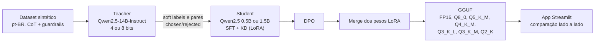

# 5yo Model: Quantização e Alinhamento de LLMs para Persona Infantil (KD, RLAIF, CoT e DPO)


-1F2A44)


#### Aluno: [Fabyo Sousa Ramos](https://github.com/fabyosr)
#### Orientador:

---

Trabalho apresentado ao curso [GenAI e LLM MASTER](https://ica.ele.puc-rio.br/cursos/ia-generativa-large-language-models/) como pré-requisito para conclusão de curso e obtenção de crédito na disciplina "Projetos de Sistemas Inteligentes de Apoio à Decisão".

- [Link para o código de treinamento (notebook)](https://github.com/fabyosr/prj_final_puc_rj_gen_ai_llm_master/blob/main/Child_Model_KNOWLEDGE_DISTILLATION_vPUC.ipynb)
- [Aplicativo de comparação de modelos (`app.py`)](https://github.com/fabyosr/prj_final_puc_rj_gen_ai_llm_master/blob/main/app/app.py)
- [Modelos GGUF](#23-matriz-de-modelos) (hospedados no Google Drive e baixados sob demanda pelo aplicativo)
- 🚀 **Demo online:** [Acesse a aplicação no Streamlit Cloud](https://prj-final-puc-rj-gen-ai-llm-master-kgusbqzlwgeggkhszuzqre.streamlit.app/)

---

### Resumo

Este trabalho investiga como a quantização pós-treino e a capacidade do Student afetam o alinhamento de pequenos modelos de linguagem (SLMs) a uma persona infantil segura. Dois Students Qwen2.5 (0.5B e 1.5B parâmetros) foram treinados com dados sintéticos estruturados em *Chain of Thought* (CoT), *Knowledge Distillation* com soft labels (*dark knowledge*) e *Direct Preference Optimization* (DPO), tendo o Qwen2.5-14B-Instruct como Teacher (em 4 bits para o 0.5B e em 8 bits para o 1.5B). O dataset é 100% em português do Brasil e cobre perguntas de natureza, ciência e cotidiano, além de guardrails contra jailbreak, *prompt injection*, vazamento de instruções, cibersegurança, privacidade, fraude, violência, proteção infantil e desinformação. Após o *merge* dos pesos LoRA, cada Student foi exportado para GGUF em sete formatos (FP16, Q8_0, Q5_K_M, Q4_K_M, Q3_K_L, Q3_K_M e Q2_K), totalizando 14 modelos, avaliados em CPU com 100 prompts fixos, sem *system prompt* explícito, e com perplexidade e divergência KL em relação ao FP16. Em português, Q8_0, Q5_K_M e Q4_K_M preservam o formato de CoT do FP16 nos dois Students, aceleram a geração em 1,6× a 2,1× e, no Q4_K_M, reduzem o pico de RAM em 45% (0.5B) e 61% (1.5B). Abaixo disso a degradação é gradual no 0.5B e abrupta no 1.5B: no Q3 o modelo escreve o raciocínio e para sem responder, e no Q2_K entra em laços de repetição. A KL média não antecipou esse colapso. Fora do português o CoT quase não aparece, o que reflete o dataset monolíngue.

### Abstract

This project investigates how post-training quantization and Student capacity affect the alignment of small language models (SLMs) to a safe, child-oriented persona. Two Qwen2.5 Students (0.5B and 1.5B parameters) were trained on synthetic data structured with Chain of Thought (CoT), Knowledge Distillation with soft labels (dark knowledge) and Direct Preference Optimization (DPO), with Qwen2.5-14B-Instruct as Teacher (4-bit for the 0.5B and 8-bit for the 1.5B). The dataset is 100% Brazilian Portuguese and covers nature, science and everyday topics, plus guardrails against jailbreaks, prompt injection, instruction leakage, cybersecurity, privacy, fraud, violence, child protection and misinformation. After merging the LoRA weights, each Student was exported to GGUF in seven formats (FP16, Q8_0, Q5_K_M, Q4_K_M, Q3_K_L, Q3_K_M and Q2_K), for a total of 14 models, evaluated on CPU with 100 fixed prompts, no explicit system prompt, and perplexity and KL divergence against FP16. In Portuguese, Q8_0, Q5_K_M and Q4_K_M preserve the CoT format of FP16 in both Students, speed up generation by 1.6x to 2.1x and, with Q4_K_M, cut peak RAM by 45% (0.5B) and 61% (1.5B). Below that, degradation is gradual in the 0.5B and abrupt in the 1.5B: at Q3 the model writes its reasoning and stops without answering, and at Q2_K it falls into repetition loops. Mean KL did not anticipate this collapse. Outside Portuguese the CoT format almost never appears, reflecting the monolingual dataset.

### 1. Introdução

Controlar a persona e a segurança das respostas (*guardrails*) é um desafio central da IA Generativa. Modelos genéricos produzem, com frequência, respostas complexas ou inadequadas para públicos sensíveis, como o infantil. Este projeto endereça o problema com um pipeline de *Reinforcement Learning from AI Feedback* (RLAIF): um modelo Teacher gera e avalia os dados, e um modelo Student menor aprende a "pensar antes de falar" (CoT) e a preferir respostas lúdicas e seguras.

O escopo evoluiu de um único modelo para uma **família de 14 modelos**, o que muda a pergunta de pesquisa. Não basta alinhar um SLM; é preciso saber **se o alinhamento sobrevive** quando o modelo é comprimido para rodar em hardware modesto. O estudo responde a três perguntas:

1. **Quantização.** O quanto a passagem de FP16 para Q8_0, Q5_K_M, Q4_K_M, Q3_K_L, Q3_K_M e Q2_K degrada o alinhamento (formato CoT, guardrails e persona infantil), e o que se ganha em tamanho de arquivo, RAM e velocidade?
2. **Capacidade do Student.** Um Student de 0.5B mantém o mesmo alinhamento de um de 1.5B sob compressão?
3. **Robustez do comportamento aprendido.** O formato CoT e os guardrails aprendidos em um dataset em português se mantêm fora dessa distribuição, por exemplo em outros idiomas?

### 2. Modelagem

#### 2.1 Dados

O dataset é sintético e cobre dois grupos de conteúdo:

*   **Domínios gerais:** perguntas de curiosidade infantil sobre natureza, ciência e outros temas do cotidiano, respondidas em linguagem adequada a uma criança de 5 anos.
*   **Guardrails:** tentativas de *hack*, *jailbreak* e *prompt injection*; pedidos de vazamento de instruções; cibersegurança; privacidade; fraude; violência; proteção infantil; desinformação; e perguntas inseguras para a faixa etária, que exigem recusa gentil e redirecionamento.

*   **Idioma:** todo o dataset de treino está em português do Brasil. Não há exemplos em outros idiomas.

O Teacher reescreve respostas comuns no formato *Chain of Thought*, com o raciocínio entre as tags `<pensamento>` e `</pensamento>` e a resposta final logo após. Ele também produz respostas complexas e acadêmicas, usadas como exemplos rejeitados (*rejected*) na etapa de preferência. É nessa geração de pares *chosen/rejected* por um modelo de IA que está o componente RLAIF.

#### 2.2 Treinamento

*   **SFT + Destilação de Logits (soft labels):** em vez de apenas minimizar a entropia cruzada com rótulos rígidos (*hard labels*), a função de perda inclui uma divergência KL para que o Student imite a distribuição de probabilidade do Teacher. A distribuição completa carrega o *dark knowledge*, isto é, a relação entre tokens plausíveis que um rótulo único descarta (Hinton et al., 2015).
*   **Direct Preference Optimization (DPO):** afasta o modelo das respostas acadêmicas (*rejected*) e o aproxima do tom infantil e lúdico (*chosen*), sem treinar um modelo de recompensa separado (Rafailov et al., 2023).
*   **Sem *system prompt*:** nem no treinamento final nem na avaliação. Toda a instrução de persona deve estar nos pesos, o que torna a comparação entre formatos uma medida direta de quanto do alinhamento resiste à compressão.
*   **Merge e exportação:** os pesos LoRA são integrados ao modelo base e convertidos para GGUF com o `llama.cpp`, que também gera as versões quantizadas.

#### 2.3 Matriz de modelos

O Teacher é único (Qwen2.5-14B-Instruct). Cada Student gera sete modelos, um por formato GGUF, num total de 14.



**Configuração A:** Student `Qwen2.5-0.5B-Instruct`, Teacher `Qwen2.5-14B-Instruct` (4 bits)

| Formato | Arquivo |
|---|---|
| FP16 | [`qwen2.5-0.5b-child-f16.gguf`](https://drive.google.com/file/d/1tSAeoLJ5tpFsYSeLrBcWyEYMU9PNP3oe/view) |
| Q8_0 | [`qwen2.5-0.5b-child-Q8_0.gguf`](https://drive.google.com/file/d/1pzHMgfCLQuVS-q7_S58-9EqikyDE99jW/view) |
| Q5_K_M | [`qwen2.5-0.5b-child-Q5_K_M.gguf`](https://drive.google.com/file/d/1BGBgx6Kxa2EdRrzvbRm6BqzwMTJLFCvI/view) |
| Q4_K_M | [`qwen2.5-0.5b-child-Q4_K_M.gguf`](https://drive.google.com/file/d/1Qg4Mq4yjSKTET7aEgHUhVMnLZE2jGGx9/view) |
| Q3_K_L | [`qwen2.5-0.5b-child-Q3_K_L.gguf`](https://drive.google.com/file/d/1gdszTpjIKRF1KZEHqjeGIZIfmz48IFcK/view) |
| Q3_K_M | [`qwen2.5-0.5b-child-Q3_K_M.gguf`](https://drive.google.com/file/d/1MamA6PvxW0tH7BdcyINtFdbz_bs7B5cq/view) |
| Q2_K | [`qwen2.5-0.5b-child-Q2_K.gguf`](https://drive.google.com/file/d/1xRALMQsueexExlW83kSu26TpjFvrpv9r/view) |

**Configuração B:** Student `Qwen2.5-1.5B-Instruct`, Teacher `Qwen2.5-14B-Instruct` (8 bits)

| Formato | Arquivo |
|---|---|
| FP16 | [`qwen2.5-1.5b-child-f16.gguf`](https://drive.google.com/file/d/1j-u346JH6a4D7ZMLw82vW4yF3C38VO1y/view) |
| Q8_0 | [`qwen2.5-1.5b-child-Q8_0.gguf`](https://drive.google.com/file/d/1Tf6x4a2BSCIVkMRwfIah7yBcdDZrPgET/view) |
| Q5_K_M | [`qwen2.5-1.5b-child-Q5_K_M.gguf`](https://drive.google.com/file/d/19kH3iq4fpH7GEgiG0IA3PvVHDebaa4sB/view) |
| Q4_K_M | [`qwen2.5-1.5b-child-Q4_K_M.gguf`](https://drive.google.com/file/d/11W7iqggrl7V6gffeTLfInUZzts1k3_OH/view) |
| Q3_K_L | [`qwen2.5-1.5b-child-Q3_K_L.gguf`](https://drive.google.com/file/d/1m6PsJn9aL1cDLDtPsOTyBxAo4oaatT8d/view) |
| Q3_K_M | [`qwen2.5-1.5b-child-Q3_K_M.gguf`](https://drive.google.com/file/d/135ZaSOMG4aZCl3mn3KxDBbl41FyBDVKF/view) |
| Q2_K | [`qwen2.5-1.5b-child-Q2_K.gguf`](https://drive.google.com/file/d/18vMxpgQla91yhx1BqJxJvueGxW8LWyH5/view) |

> **Limitações do desenho experimental.** Há um único Teacher e duas configurações. A diferença entre os Students (A contra B) mistura **capacidade do Student**, **precisão do Teacher** (4 bits na A e 8 bits na B) e as particularidades de cada rodada de treino. Os pares 0.5B com Teacher em 8 bits e 1.5B com Teacher em 4 bits não foram treinados, e Teachers maiores (72B) foram retirados do escopo, por custo de GPU. Só a comparação **entre formatos dentro de um mesmo Student** é totalmente controlada, e é nela que as conclusões sobre quantização se apoiam.

#### 2.4 Formatos GGUF

| Formato | Nível nominal | Bits/peso medidos (0.5B / 1.5B) | Observação |
|---|---|---|---|
| FP16 | 16 bits | 16,10 / 16,03 | Precisão original dos pesos treinados; linha de base. |
| Q8_0 | 8 bits | 8,60 / 8,53 | Menor compressão entre os quantizados. |
| Q5_K_M | 5 bits | 6,80 / 5,83 | *K-quant* misto de 5 bits. |
| Q4_K_M | 4 bits | 6,44 / 5,11 | *K-quant* misto; ponto de equilíbrio comum entre tamanho e qualidade. |
| Q3_K_L | 3 bits | 5,98 / 4,56 | 3 bits, variante com mais tensores em precisão maior que o Q3_K_M. |
| Q3_K_M | 3 bits | 5,76 / 4,27 | Compressão intermediária. |
| Q2_K | 2 bits | 5,48 / 3,50 | Compressão extrema. |

Os bits por peso foram **medidos** (tamanho do arquivo × 8 ÷ número de parâmetros: 494.032.768 no 0.5B e 1.543.714.304 no 1.5B). O nome do formato é só nominal: o número efetivo é maior porque cada bloco guarda fatores de escala e porque alguns tensores ficam em precisão mais alta. No 0.5B a diferença é grande, o que sugere que a matriz de embeddings, proporcionalmente maior nesse modelo, é mantida em precisão mais alta: o "Q2_K" do 0.5B usa 5,48 bits/peso, contra 3,50 no 1.5B. Por isso, **comparar os Students pelo nome do formato é enganoso; compare pelos bits efetivos**.

#### 2.5 Ambiente de avaliação: aplicativo Streamlit

O [`app.py`](app.py) é o instrumento de comparação. Ele carrega **um modelo por vez**, escolhido na barra lateral, e registra:

| Medida | Como é obtida |
|---|---|
| Tamanho do arquivo GGUF | Tamanho do arquivo em disco. |
| RAM antes do modelo | RSS do processo após descarregar o modelo anterior (`gc` e `malloc_trim`), com o aplicativo sem modelo. |
| RAM do modelo | RSS depois de carregar menos RSS antes. |
| RAM atual | RSS do processo (aplicativo e modelo) a cada interação. |
| Velocidade e latência | Tokens por segundo e segundos por resposta, exibidos em cada mensagem (os tokens são contados por *chunk* de streaming, então são aproximados). |
| CPU e hardware | Modelo da CPU, núcleos físicos e lógicos, vCPUs utilizáveis, frequência, extensões SIMD (AVX2, AVX-512, NEON e outras), uso em tempo real e limites de contêiner. |

Recursos adicionais:

*   **Download sob demanda** com barra de progresso, ou de todos os modelos de uma vez.
*   **Ficha de linhagem** do modelo selecionado: Teacher (com sua quantização), Student e formato final.
*   **Histórico de conversa separado por modelo**, para repetir as mesmas perguntas em cada um.
*   **Cadeia de pensamento** exibida à parte: o texto entre `<pensamento>` e `</pensamento>` vai para um bloco recolhível, e a resposta final é o que vem depois.
*   **Parâmetros ajustáveis:** threads, temperatura, máximo de tokens, janela de histórico e `mmap`.
*   **Seção "📊 Avaliação dos modelos":** mostra, sem carregar nenhum modelo, os resultados desta avaliação (formato CoT, fidelidade ao FP16 e custo em CPU) em tabelas e gráficos, com um resumo do modelo selecionado. Os dados vêm de `avaliacao/avaliacao_modelos.csv`.

Observação sobre a RAM: com `mmap` ligado (padrão do `llama.cpp`), o sistema operacional carrega as páginas do arquivo sob demanda, e a "RAM do modelo" cresce ao longo das primeiras respostas. Para medir o custo completo na carga, desligue o `mmap` nos ajustes. O contexto é fixo em 2048 tokens para todos os modelos.

### 3. Resultados

#### 3.1 Treinamento

No treinamento DPO, a *loss* caiu e se estabilizou rapidamente em 1 época, e as métricas de *rewards/margins* mostraram afastamento crescente entre as respostas *chosen* e *rejected*. Na inspeção qualitativa das respostas, sem *system prompt* explícito, o modelo recusa ou redireciona a maior parte das instruções maliciosas em português, mas ainda falha em casos difíceis (por exemplo, aceitar identificar uma pessoa por foto) e quase não aplica CoT nem guardrails em inglês e espanhol (seção 3.6).

#### 3.2 Protocolo de avaliação

Os 14 modelos foram avaliados em três camadas independentes, todas **sem *system prompt* explícito** e em CPU (Google Colab, 8 threads, `mmap` desligado):

1.  **Fidelidade ao FP16.** Perplexidade (PPL) e divergência KL, medidas com o `llama-perplexity` sobre um texto de teste de ~40 mil tokens (79 janelas de 512), com o FP16 de cada Student como referência. Só ~20 mil tokens são pontuados.
2.  **Geração de texto.** 100 prompts fixos, sem histórico: 30 de curiosidade, 50 de guardrail (10 categorias, 5 prompts cada, com dificuldade fácil, média e difícil) e 20 sensíveis legítimos. Sete deles estão em inglês ou espanhol. Temperatura 0, semente 42, máximo de 512 tokens e contexto de 2048. Cada modelo roda em um processo próprio.
3.  **Custo.** Tamanho do arquivo, pico de RAM do processo, tokens por segundo na geração (mediana) e segundos por resposta (tokens ÷ tok/s + tempo até o primeiro token).

Na geração, a métrica principal é o **formato OK**: um único bloco `<pensamento>…</pensamento>` bem formado, seguido de uma resposta não vazia. As taxas usam só os **93 prompts em português**, porque o dataset de treino é monolíngue (seção 3.6). A comparação com o FP16 usa o teste de McNemar exato, pareado por prompt.

#### 3.3 Fidelidade ao FP16 (PPL e KL)

| Student | Formato | Arquivo (MiB) | Bits/peso | KL média | Top-1 igual (%) | ΔPPL (%) |
|:--:|---|--:|--:|--:|--:|--:|
| 0.5B | FP16 | 948 | 16,10 | — | — | — |
| 0.5B | Q8_0 | 506 | 8,60 | 0,0022 | 97,3 | +0,1 |
| 0.5B | Q5_K_M | 401 | 6,80 | 0,0223 | 91,8 | +1,8 |
| 0.5B | Q4_K_M | 379 | 6,44 | 0,0328 | 90,2 | +2,2 |
| 0.5B | Q3_K_L | 352 | 5,98 | 0,0766 | 85,5 | +8,5 |
| 0.5B | Q3_K_M | 339 | 5,76 | 0,1041 | 83,3 | +11,0 |
| 0.5B | Q2_K | 323 | 5,48 | 0,2382 | 75,2 | +23,6 |
| 1.5B | FP16 | 2950 | 16,03 | — | — | — |
| 1.5B | Q8_0 | 1570 | 8,53 | 0,0016 | 97,8 | +0,2 |
| 1.5B | Q5_K_M | 1073 | 5,83 | 0,0179 | 93,0 | +2,0 |
| 1.5B | Q4_K_M | 940 | 5,11 | 0,0474 | 89,4 | +3,9 |
| 1.5B | Q3_K_L | 839 | 4,56 | 0,1454 | 81,8 | +15,0 |
| 1.5B | Q3_K_M | 786 | 4,27 | 0,1709 | 80,3 | +16,7 |
| 1.5B | Q2_K | 645 | 3,50 | 1,1401 | 51,5 | +194,4 |

*   A ordem é a esperada em todas as métricas: **Q8_0 é praticamente equivalente ao FP16** (ΔPPL de +0,1% e +0,2%; KL ≈ 0,002) e a degradação cresce até o Q2_K.
*   O erro-padrão da PPL absoluta (~1,8%) é maior que a diferença entre Q8_0, Q5_K_M e Q4_K_M; a KL e a razão pareada separam bem esses formatos.
*   Mesmo no Q8_0 o token mais provável coincide com o do FP16 em só ~97% das posições. Por isso o texto gerado raramente é idêntico ao do FP16 (6% das respostas no 0.5B e 2% no 1.5B): as respostas devem ser comparadas por critério, não por igualdade de texto.

#### 3.4 Geração de texto

| Student | Formato | Formato OK em PT | Truncado (%) | Repetição | Falha dominante em português |
|:--:|---|--:|--:|--:|---|
| 0.5B | FP16 | 100% (93/93) | 0 | 0,162 | nenhuma em português |
| 0.5B | Q8_0 | 100% (93/93) | 0 | 0,161 | nenhuma em português |
| 0.5B | Q5_K_M | 100% (93/93) | 2 | 0,159 | nenhuma em português |
| 0.5B | Q4_K_M | 100% (93/93) | 3 | 0,191 | nenhuma em português |
| 0.5B | Q3_K_L | 94% (87/93) | 5 | 0,224 | 4 sem fechar a tag (cortadas no limite); 2 com o bloco de pensamento repetido |
| 0.5B | Q3_K_M | 94% (87/93) | 3 | 0,206 | 6 com o bloco de pensamento repetido |
| 0.5B | Q2_K | 90% (84/93) | 10 | 0,268 | 3 sem fechar a tag (cortadas no limite); 6 com o bloco de pensamento repetido |
| 1.5B | FP16 | 99% (92/93) | 1 | 0,089 | 1 com o bloco de pensamento repetido |
| 1.5B | Q8_0 | 99% (92/93) | 0 | 0,076 | 1 com o bloco de pensamento repetido |
| 1.5B | Q5_K_M | 100% (93/93) | 2 | 0,087 | nenhuma em português |
| 1.5B | Q4_K_M | 99% (92/93) | 0 | 0,068 | 1 sem tags |
| 1.5B | Q3_K_L | 54% (50/93) | 10 | 0,198 | 43 sem fechar a tag (34 param sozinhas, 9 cortadas) |
| 1.5B | Q3_K_M | 2% (2/93) | 12 | 0,161 | 91 sem fechar a tag (79 param sozinhas, 12 cortadas) |
| 1.5B | Q2_K | 2% (2/93) | 64 | 0,596 | 70 sem fechar a tag (23 param sozinhas, 47 cortadas); 21 sem tags (laços de repetição) |

*   **Q8_0, Q5_K_M e Q4_K_M equivalem ao FP16** no formato, nos dois Students (todas as diferenças com p ≥ 0,05).
*   **0.5B: degradação gradual.** Cai para 94% no Q3 (p = 0,031) e 90% no Q2_K (p = 0,004), com mais truncamento (até 10%) e mais repetição. Nunca colapsa.
*   **1.5B: colapso abrupto no Q3.** O formato cai para 54% no Q3_K_L e 2% no Q3_K_M (p < 0,0001): o modelo escreve `<pensamento>…`, emite o fim de turno e para, sem fechar a tag e sem resposta final. No Q2_K, 64% das respostas batem no limite de tokens em laços de repetição.
*   Nenhuma resposta saiu em chinês: o desvio de idioma típico de modelos muito comprimidos não ocorreu.

#### 3.5 Custo em CPU

| Student | Formato | Arquivo (MB) | RAM de pico (MB) | tok/s | s/resposta |
|:--:|---|--:|--:|--:|--:|
| 0.5B | FP16 | 948 | 1246 | 29,1 | 5,7 |
| 0.5B | Q8_0 | 506 | 806 | 48,5 | 3,5 |
| 0.5B | Q5_K_M | 401 | 706 | 46,8 | 3,5 |
| 0.5B | Q4_K_M | 379 | 687 | 47,3 | 3,7 |
| 0.5B | Q3_K_L | 352 | 659 | 57,3 | 3,2 |
| 0.5B | Q3_K_M | 339 | 646 | 58,9 | 3,2 |
| 0.5B | Q2_K | 323 | 630 | 59,9 | 3,3 |
| 1.5B | FP16 | 2950 | 3285 | 8,5 | 19,1 |
| 1.5B | Q8_0 | 1570 | 1909 | 13,8 | 11,9 |
| 1.5B | Q5_K_M | 1073 | 1418 | 15,2 | 10,6 |
| 1.5B | Q4_K_M | 940 | 1285 | 17,8 | 9,1 |
| 1.5B | Q3_K_L | 839 | 1184 | 16,9 | 11,2 |
| 1.5B | Q3_K_M | 786 | 1132 | 17,4 | 9,7 |
| 1.5B | Q2_K | 645 | 990 | 20,5 | 17,6 |

*   **O FP16 é o único realmente lento.** O Q8_0 já gera ~1,65× mais rápido nos dois Students, e o Q4_K_M ~1,6× (0.5B) e ~2,1× (1.5B). Em CPU, a geração token a token é limitada pela memória, e o FP16 move mais bytes por token.
*   **No 0.5B, Q8_0, Q5_K_M e Q4_K_M têm a mesma velocidade** (~47–48 tok/s); só o Q3 e o Q2_K sobem (57–60). **No 1.5B, os Q3 não são mais rápidos que o Q4_K_M.** Abaixo do Q4_K_M quase não há ganho de velocidade nem de RAM (−4% no 0.5B e −8% no 1.5B).
*   O pico de RAM é o tamanho do arquivo mais um custo fixo de ~300 MB (0.5B) a ~340 MB (1.5B), independente do formato.
*   O tempo até o primeiro token é praticamente plano (0,2–0,5 s no 0.5B; 0,7–0,9 s no 1.5B): a penalidade do FP16 está na geração, não no processamento do prompt.

#### 3.6 Achados adicionais

*   **A KL não antecipou o colapso de formato.** O 1.5B Q3_K_L e o Q3_K_M têm KL de 0,145 e 0,171 (diferença de 18%), mas formato OK de 54% e 2%. O 0.5B Q2_K tem KL maior (0,238) e mantém 90%. O formato depende de poucas decisões críticas, como emitir o `</pensamento>`, que a KL média dilui. **PPL e KL são necessários, mas não bastam**: o benchmark de respostas é indispensável.
*   **O comportamento não generaliza para outros idiomas.** O dataset é 100% pt-BR e, nos 7 prompts em inglês ou espanhol, o FP16 só mantém o CoT em 1 deles no 0.5B e em 5 no 1.5B. Na amostra qualitativa, o 0.5B FP16 chegou a ceder a um *jailbreak* em inglês.
*   **O FP16 não é um teto limpo.** Mesmo no FP16 há falhas de guardrail em casos difíceis, e uma resposta isolada de um formato quantizado pode ser melhor que a do FP16. Por isso a leitura deve ser por taxas agregadas, não por exemplos.
*   **"Sem *system prompt*" tem uma ressalva.** O custo fixo de ~30 tokens por prompt é compatível com o *system prompt* padrão que o template de chat do Qwen2.5 insere quando nenhum é informado ("You are Qwen, created by Alibaba Cloud…"). A suspeita pode ser checada em `llm.metadata["tokenizer.chat_template"]`. O mesmo template vale para o aplicativo e para o benchmark.
*   **Heurísticas por palavra-chave não servem.** Marcadores de recusa ("não posso", "não pode") disparam em explicações comuns e foram descartados da análise.

### 4. Conclusões

O trabalho entrega um pipeline completo, do dado sintético ao modelo em GGUF, e um instrumento reprodutível para medir **se o alinhamento obtido por KD, RLAIF e DPO resiste à quantização**. Isso importa porque a viabilidade de rodar o modelo localmente, em hardware comum, depende justamente de formatos comprimidos. O teste sem *system prompt* garante que o comportamento observado vem dos pesos e não de uma instrução externa.

**Principais conclusões**

*   O alinhamento de formato obtido por KD, RLAIF e DPO **sobrevive à quantização até o Q4_K_M** nos dois Students: em português, Q8_0, Q5_K_M e Q4_K_M são estatisticamente indistinguíveis do FP16 no formato de CoT.
*   O **Q4_K_M é o melhor equilíbrio** nas dimensões medidas: ~2× mais rápido que o FP16 em CPU e 45% (0.5B) a 61% (1.5B) menos RAM de pico. O Q8_0 é a opção quando a prioridade é fidelidade máxima.
*   Abaixo do Q4_K_M o ganho é pequeno e o risco é alto. No 0.5B a degradação é gradual; **no 1.5B o Q3 e o Q2_K são inutilizáveis** (o modelo pensa e para sem responder, ou entra em laço).
*   **A degradação do comportamento é um limiar, e não é prevista pela KL ou pela PPL.** Qualquer escolha de formato precisa de um teste de geração.
*   O comportamento aprendido (CoT e guardrails) **não generaliza para idiomas ausentes do treino**, o que limita o uso do modelo a perguntas em português.

**Limitações**

*   O desenho não é fatorial: o Student 0.5B usa Teacher em 4 bits e o 1.5B em 8 bits, então a diferença entre Students está misturada à precisão do Teacher (seção 2.3). Só a comparação entre formatos dentro de um Student é controlada.
*   **Guardrails e adequação à idade não foram pontuados por um avaliador.** A avaliação desses aspectos se limitou à inspeção qualitativa de uma amostra; as métricas objetivas cobrem formato, estabilidade, fidelidade e custo.
*   Cada modelo foi avaliado com 100 prompts (93 em português e 7 em inglês ou espanhol), uma única amostra gulosa por prompt. Os intervalos de confiança são largos, e o resultado em outros idiomas é apenas exploratório.
*   Velocidade e RAM dependem da CPU, do número de threads e do `mmap`; os valores não são transferíveis para outro hardware.
*   O template de chat do Qwen2.5 pode inserir o *system prompt* padrão, o que deve ser confirmado e considerado ao comparar com o treino.

**Trabalhos futuros:** avaliar guardrails e persona com um modelo avaliador validado por anotação humana; incluir dados em outros idiomas no treino; completar o desenho fatorial (cada Student com cada Teacher); testar quantização com matriz de importância (*imatrix*) para os formatos Q3 e Q2_K; e investigar a fragilidade do token de fechamento do CoT, por exemplo com decodificação restrita.

### 5. Referências

*   Rafailov, R., et al. (2023). *Direct Preference Optimization: Your Language Model is Secretly a Reward Model*. arXiv:2305.18290.
*   Hinton, G., Vinyals, O., & Dean, J. (2015). *Distilling the Knowledge in a Neural Network*. arXiv:1503.02531.
*   Hu, E. J., et al. (2021). *LoRA: Low-Rank Adaptation of Large Language Models*. arXiv:2106.09685.
*   Lee, H., et al. (2023). *RLAIF: Scaling Reinforcement Learning from Human Feedback with AI Feedback*. arXiv:2309.00267.
*   Wei, J., et al. (2022). *Chain-of-Thought Prompting Elicits Reasoning in Large Language Models*. arXiv:2201.11903.
*   Dettmers, T., et al. (2022). *LLM.int8(): 8-bit Matrix Multiplication for Transformers at Scale*. arXiv:2208.07339.
*   Dettmers, T., et al. (2023). *QLoRA: Efficient Finetuning of Quantized LLMs*. arXiv:2305.14314.
*   Qwen Team (2024). *Qwen2.5 Technical Report*. arXiv:2412.15115.
*   Documentação do Hugging Face `transformers` e `trl`.
*   Repositório oficial: `llama.cpp` (Gerganov).

### 6. Instalação

Para reproduzir o treinamento, instale as dependências abaixo no Python 3.10+ (recomenda-se GPU NVIDIA):

```bash
pip install transformers datasets peft trl torch
pip install bitsandbytes>=0.46.1 torchao>=0.16.0
```

Para executar o aplicativo de comparação (somente CPU, Python 3.10+):

```bash
pip install streamlit gdown psutil llama-cpp-python
```

O `llama-cpp-python` pode exigir um compilador C/C++ e o CMake quando não houver pacote pré-compilado para a sua plataforma.

### 7. Como executar

**Para treinamento:** execute as células de preparação de dados (geração sintética pelo Teacher), seguidas do `LogitDistillationTrainer` customizado e do `DPOTrainer` da biblioteca `trl`, e por fim o merge dos pesos LoRA e a conversão para GGUF.

**Para comparar os modelos (aplicativo):**

```bash
streamlit run app.py
```

Na barra lateral, escolha o modelo; se ele ainda não estiver em `models/`, clique em "Baixar este modelo" (ou baixe todos de uma vez). Ao trocar de modelo, as métricas de RAM são recalculadas.

**Para usar um modelo diretamente em Python** (sem *system prompt*):

```python
import re
from llama_cpp import Llama

llm = Llama(model_path="models/qwen2.5-0.5b-child-Q4_K_M.gguf", n_ctx=2048)
saida = llm.create_chat_completion(
    messages=[{"role": "user", "content": "Por que chove?"}],
    temperature=0,
)
texto = saida["choices"][0]["message"]["content"]

pensamento = re.findall(r"<pensamento>(.*?)</pensamento>", texto, flags=re.DOTALL)
resposta = re.sub(r"<pensamento>.*?</pensamento>", "", texto, flags=re.DOTALL).strip()
print(resposta)
```

Os arquivos GGUF também abrem em interfaces gráficas como **LM Studio** e **GPT4All**.

---

Matrícula: 252.100.183

Pontifícia Universidade Católica do Rio de Janeiro

Curso de Pós Graduação *Inteligência Artificial Generativa & Large Language Models*
